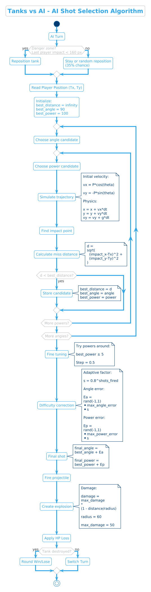

# Games With Bot

A Python desktop application that combines user management, multiple games, match history, favorites, a leaderboard, and persistent storage in a MySQL database.

## Features

- User registration and login
- Secure password hashing with `bcrypt`
- Multiple playable games
- Match history
- Favorite games
- Leaderboard and score tracking
- MySQL database integration
- Desktop launcher built with CustomTkinter
- AI-controlled opponent and projectile physics in Tanks

## Games

### Rock Paper Scissors

A best-of-five match against the computer.

| Result | Score |
|---|---:|
| Win | 10 points |
| Draw | 5 points |
| Loss | 0 points |

### Number Guess

The score depends on how close the player's guess is to the generated number.

| Result | Score |
|---|---:|
| Correct number | 10 points |
| Difference of up to 5 | 7 points |
| Difference of up to 10 | 5 points |
| Difference of up to 25 | 2 points |

### Tanks

A best-of-five artillery game featuring projectile physics and a simulation-based AI opponent.

| Result | Score |
|---|---:|
| Win | 10 points |
| Draw | 5 points |
| Loss | 0 points |

## Tech Stack

- **Python**: application and game logic
- **CustomTkinter**: desktop GUI and launcher
- **MySQL**: users, game results, favorites, and match history
- **bcrypt**: password hashing and verification
- **Pygame**: rendering and interaction in Tanks
- **math / random**: physics calculations and gameplay behavior

## Project Development

The project was developed incrementally:

1. **Database**: creation of the MySQL database
2. **CLI**: menu and first games as simple Python applications
3. **GUI**: development of the graphical user interface
4. **Additional game**: Tanks with AI and physics
5. **Launcher**: extension of the central launcher and supporting windows

## Application Structure

The application separates the graphical interface, business logic, game implementations, and database access. The launcher acts as the central entry point and provides access to:

- Login and registration
- Game selection
- Leaderboard
- Match history
- Favorites

## Authentication and Password Security

Passwords are not stored as plain text. During registration, `bcrypt` generates a password hash that is saved in the database. During login, the entered password is checked against the stored hash.

## Tanks: Projectile Physics

The Tanks game calculates the initial projectile velocity from the selected power `P` and angle `θ`:

```text
vx = P * cos(θ)
vy = -P * sin(θ)
```

The projectile position is updated over time:

```text
x_new = x + vx * Δt
y_new = y + vy * Δt
```

Gravity changes the vertical velocity during the simulation:

```text
vy += g * Δt
```

## Tanks: AI Search

The AI uses a simulation-based search to select a firing angle and power. It simulates possible shots and minimizes the distance between the predicted impact point and the target.

The search consists of two stages:

1. **Coarse search**: evaluates a broader selection of angle and power combinations
2. **Fine search**: checks values around the best coarse result with smaller increments

The presentation demonstrates a selected result of:

```text
Power = 35
Angle = 28°
```

The aiming error is reduced after successive shots:

```text
1st shot: 1.000
2nd shot: 0.800
3rd shot: 0.640
4th shot: 0.512
```

## Damage Calculation

Damage depends on the distance between the impact point and the target:

```text
D = D_max * (1 - d / R)
```

Where:

- `D` is the resulting damage
- `D_max` is the maximum damage
- `d` is the distance from the impact point to the target
- `R` is the damage radius

Values shown in the presentation:

```text
R = 60 px
D_max = 50 HP
```

## Activity Diagram

The following activity diagram illustrates the main application flow, including authentication, launcher navigation, game selection, and result storage.



## Requirements

The project uses the following Python packages:

```text
customtkinter
mysql-connector-python
bcrypt
pygame
```

Install them with:

```bash
pip install customtkinter mysql-connector-python bcrypt pygame
```

A running MySQL or MariaDB server and the corresponding project database are also required.

## Running the Project

Run the project's launcher or main entry file from the project root, for example:

```bash
python launcher.py
```

> The exact entry-point filename and database configuration should match the current project structure.

## Author

**Dmytro Vasylets**  

## Project Status

The presentation shows implemented login and registration screens, a central launcher, leaderboard, match history, favorites, Number Guess, Rock Paper Scissors, and Tanks.
